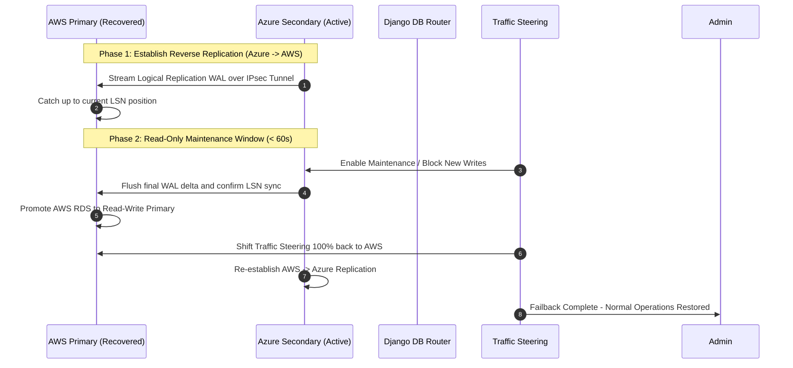

# Project Ragnarock: Cross-Cloud Automated DR Failback Runbook (Azure -> AWS)

## 1. Objective & Pre-conditions
Failback restores primary operational state to AWS us-east-1 after an outage or DR exercise.

**Pre-conditions:**
1. AWS us-east-1 infrastructure fully restored and health verified (`/healthz` responding).
2. Network connectivity across Site-to-Site IPsec VPN re-established.
3. Database replication from Azure (acting primary) back to AWS (acting secondary) synchronized with zero lag delta.

---

## 2. Reverse Replication & Failback Workflow



---

## 3. Execution Steps

### Step 3.1: Establish Reverse Logical Replication
Create publication on Azure PostgreSQL (active primary):
```sql
CREATE PUBLICATION pub_ragnarock_azure_to_aws FOR ALL TABLES;
```
Create subscription on AWS RDS PostgreSQL (recovered secondary):
```sql
CREATE SUBSCRIPTION sub_ragnarock_azure_to_aws 
CONNECTION 'host=10.200.20.5 port=5432 dbname=ragnarock_db user=ragnarock_admin password=***' 
PUBLICATION pub_ragnarock_azure_to_aws;
```

### Step 3.2: Verify Zero LSN Lag Delta
Query replication status on Azure:
```sql
SELECT client_addr, application_name, state, sync_state, 
       pg_wal_lsn_diff(pg_current_wal_lsn(), replay_lsn) AS lag_bytes
FROM pg_stat_replication;
```
Ensure `lag_bytes` equals `0`.

### Step 3.3: Switch Routing Control
Reset container environment variable `DR_FAILOVER_ACTIVE=false` across AWS and Azure deployments.
Update Route 53 ARC to return 100% traffic weight to AWS Primary.

### Step 3.4: Re-establish Standard AWS -> Azure Replication Direction
Drop reverse publication/subscription and activate standard `AWS -> Azure` logical replication subscription.
