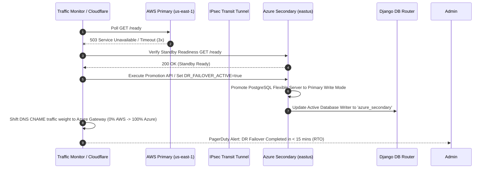

# Project Ragnarock: Cross-Cloud Automated DR Failover Runbook (AWS -> Azure)

## 1. Trigger Conditions
Automated failover is triggered when:
- **Primary AWS Health Check Failure**: Route 53 / Cloudflare Health Check detects 3 consecutive failed liveness/readiness probes (`/healthz` or `/ready`) from AWS us-east-1 ALB over a 60-second window.
- **AWS Region Outage**: AWS us-east-1 status degradation declared or primary RDS unreachable.
- **Manual Operational Override**: Executed during scheduled DR drill testing.

---

## 2. Automated Failover Execution Workflow



---

## 3. Step-by-Step Operator Procedure

### Step 3.1: Verify Standby Azure Environment
Execute readiness check against Azure secondary endpoint:
```bash
curl -i http://azure-dr.ragnarock.internal/ready
```
Ensure HTTP status is `200 OK` and Azure database connection is `UP`.

### Step 3.2: Promote Azure PostgreSQL Standby Database
If PostgreSQL logical replication is active, break replication subscription and advance WAL position to turn standby into an independent read-write primary:
```sql
-- Executed on Azure PostgreSQL Flexible Server
ALTER SUBSCRIPTION sub_ragnarock_aws_to_azure DISABLE;
ALTER SUBSCRIPTION sub_ragnarock_aws_to_azure SET (publication_names = NONE);
SELECT pg_replication_origin_advance('pg_sub_ragnarock', '0/0');
```

### Step 3.3: Set Failover Flag on Application Nodes
Update container environment variable `DR_FAILOVER_ACTIVE=true` across Azure App Service / AKS deployment:
```bash
kubectl set env deployment/ragnarock-backend DR_FAILOVER_ACTIVE=true -n ragnarock-prod
kubectl rollout status deployment/ragnarock-backend -n ragnarock-prod
```

### Step 3.4: Shift DNS Global Traffic Steering
Update Route 53 Application Recovery Controller (ARC) routing control state or Cloudflare Traffic Steering:
```bash
# Shift AWS Weight to 0, Azure Weight to 100
aws route53-recovery-control-config update-routing-control-states \
    --routing-control-states-entries RoutingControlArn=arn:aws:route53-recovery-control::123:control/aws-primary,RoutingControlState=Off RoutingControlArn=arn:aws:route53-recovery-control::123:control/azure-secondary,RoutingControlState=On
```

### Step 3.5: Validate Post-Failover CRUD Operations
Execute data benchmark check:
```bash
curl -X POST http://api.ragnarock.io/api/data \
  -H "Content-Type: application/json" \
  -d '{"sequence_number": 9001, "payload_data": "post-failover-validation-check"}'
```
Verify that payload response contains `"origin_cloud": "AZURE"`.
